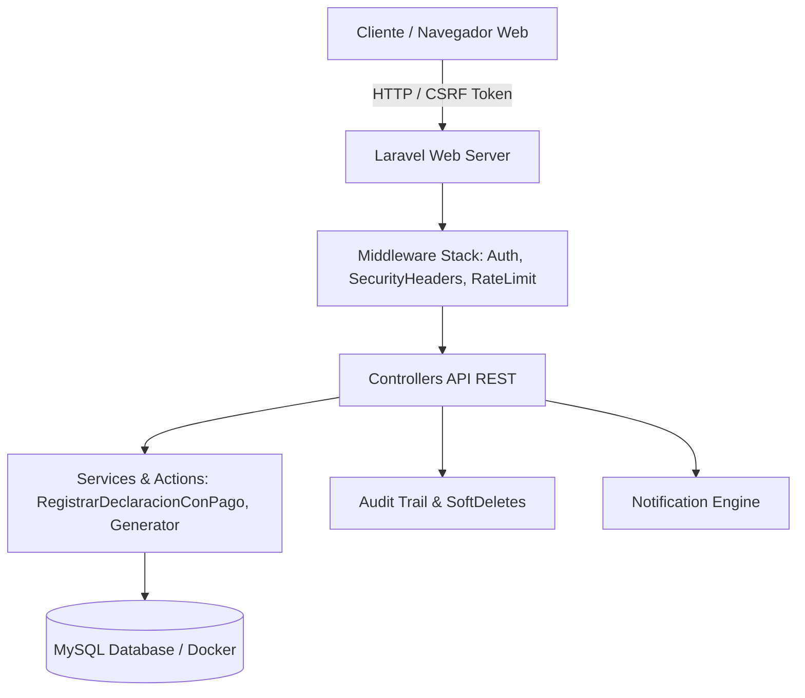

# 🚢 Sistema Aduanero — Gestión Aduanera, Declaraciones y Pagos

[](https://laravel.com)
[](https://php.net)
[](https://developer.mozilla.org/es/docs/Web/JavaScript)
[](https://vitejs.dev)
[](https://mysql.com)
[](https://docker.com)
[](#-suite-de-pruebas)

Plataforma empresarial de **Gestión Aduanera y Operaciones Financieras**, diseñada bajo arquitectura monolítica moderna con **Laravel 11** en el backend y **JavaScript Vanilla SPA (Single Page Application)** en el frontend.

El sistema permite la administración integral de clientes, generación correlativa secuencial de declaraciones aduaneras, registro de abonos y pagos parciales con cálculo automático de saldos pendientes, control de roles (RBAC), auditoría completa y registro de notificaciones en tiempo real.

---

## 🌟 Características Principales

### 📦 1. Operaciones Aduaneras y Declaraciones
* **Generación Correlativa Automatizada:** Código secuencial dinámico `DA-001`, `DA-002`, etc., asignado mediante transacciones atómicas.
* **Cálculo Automático de Estado:** Estado de declaración calculado dinámicamente (`pendiente` vs `pagado`) según el acumulado de abonos confirmados.
* **Pagos Parciales y Restricción de Sobrepago:** Validación estricta que impide registrar pagos por encima del saldo aduanero restante.

### 👤 2. Gestión de Clientes
* **Validación de Cédula Ecuatoriana:** Verificación del algoritmo del último dígito del Registro Civil Ecuatoriano.
* **Integridad Referencial Estricta:** Protección contra borradoaccidental de clientes con declaraciones vigentes.
* **Normalización de Nombres:** Sanitización automática de espacios y formato de texto.

### ⚙️ 3. Configuración del Sistema y Control de Usuarios (RBAC)
* **Gestión de Usuarios:** Creación y control de roles (`admin`, `operador`, `consultor`).
* **Sección de Configuración:** Información técnica del sistema, estadísticas de base de datos y estado de servicios.
* **Notificaciones del Sistema:** Panel de notificaciones internas y recordatorios automáticos de declaraciones pendientes vía Artisan Command.

### 🔒 4. Seguridad Empresarial y Auditoría
* **Auditoría Global (`HasAuditAndSoftDeletes`):** Trazabilidad de `created_by`, `updated_by`, `deleted_by` e hipervínculos de Soft Deletes.
* **Cabeceras de Seguridad:** Middleware HTTP que inyecta `X-Frame-Options`, `X-Content-Type-Options`, `X-XSS-Protection` y `Content-Security-Policy`.
* **Protección CSRF y Rate Limiting:** Encriptación de sesiones y throttling adaptativo para prevención de fuerza bruta.

---

## 🛠️ Tecnologías y Arquitectura



* **Backend:** Laravel 11.x, PHP 8.2+
* **Frontend:** JavaScript ES6+ (SPA con módulos ES), Vanilla CSS con variables de diseño, HTML5 semántico
* **Base de Datos:** MySQL 8.0 (Dockerizado) / SQLite
* **Compilación Frontend:** Vite 5.x
* **Pruebas:** PHPUnit & Laravel Testing Tools

---

## 🚀 Instalación y Despliegue Local

### Requisitos Previos
* PHP >= 8.2
* Composer
* Node.js >= 18.x & npm
* MySQL o Docker

### Pasos de Instalación

1. **Clonar el repositorio:**
   ```bash
   git clone https://github.com/nicolelavayen31/Sistema-Aduanero-.git
   cd Sistema-Aduanero-
   ```

2. **Instalar dependencias:**
   ```bash
   composer install
   npm install
   ```

3. **Configurar el entorno:**
   ```bash
   cp .env.example .env
   php artisan key:generate
   ```

4. **Ejecutar migraciones y seeders:**
   ```bash
   php artisan migrate --seed
   ```

5. **Crear usuario administrador inicial:**
   ```bash
   php artisan app:create-user
   ```

6. **Iniciar el servidor de desarrollo y Vite:**
   En dos terminales separadas:
   ```bash
   # Terminal 1: Servidor Laravel
   php artisan serve

   # Terminal 2: Compilador Frontend
   npm run dev
   ```

7. **Acceder a la aplicación:**
   Abre tu navegador e ingresa a `http://127.0.0.1:8000`.

---

## 🧪 Suite de Pruebas Automatizadas

El proyecto cuenta con una cobertura completa de pruebas integrales de backend que verifican autenticación, reglas de negocio, integridad de pagos, RBAC y seguridad HTTP:

```bash
php artisan test
```

**Resultado actual:**
```text
  PASS  Tests\Unit\ExampleTest
  PASS  Tests\Feature\AuthenticationTest
  PASS  Tests\Feature\IntegrityAndPaymentTest
  PASS  Tests\Feature\OperacionesApiTest
  PASS  Tests\Feature\SecurityAndAuditTest
  PASS  Tests\Feature\UserAndNotificationTest

  Tests:    36 passed (262 assertions)
```

---

## 📡 Matriz de Endpoints API

| Método | Endpoint | Descripción | Roles Autorizados |
| :--- | :--- | :--- | :--- |
| `GET` | `/api/health` | Health Check y estado del servidor | Público |
| `GET` | `/api/me` | Usuario autenticado actual y rol | Autenticado |
| `GET` | `/api/catalogos` | Tipos de declaración, métodos y estados | Autenticado |
| `GET` | `/api/dashboard/estadisticas` | Estadísticas globales del Dashboard | Autenticado |
| `GET` | `/api/clientes` | Listado paginado y búsqueda de clientes | Autenticado |
| `POST` | `/api/clientes` | Registro de nuevo cliente | Operador, Admin |
| `DELETE`| `/api/clientes/{id}` | Eliminación segura de cliente | Admin |
| `GET` | `/api/declaraciones` | Listado paginado de declaraciones | Autenticado |
| `POST` | `/api/declaraciones/con-pago` | Registro transaccional de declaración + pago | Operador, Admin |
| `POST` | `/api/declaraciones/{id}/pagos` | Registrar abono adicional a declaración | Operador, Admin |
| `GET` | `/api/pagos` | Historial paginado de pagos | Autenticado |
| `GET` | `/api/users` | Gestión de usuarios del sistema | Admin |
| `POST` | `/api/users` | Crear nuevo usuario del sistema | Admin |
| `GET` | `/api/notifications` | Notificaciones del usuario | Autenticado |

---

## 📄 Licencia

Este proyecto fue desarrollado bajo estándares profesionales para gestión aduanera y operaciones financieras.
